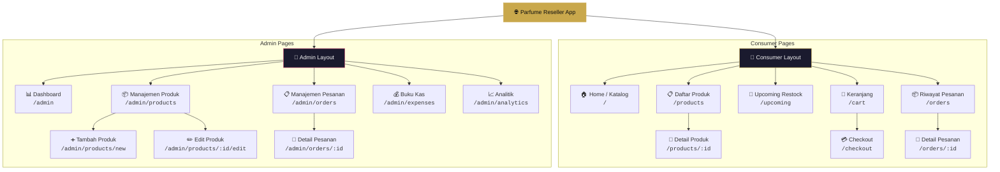
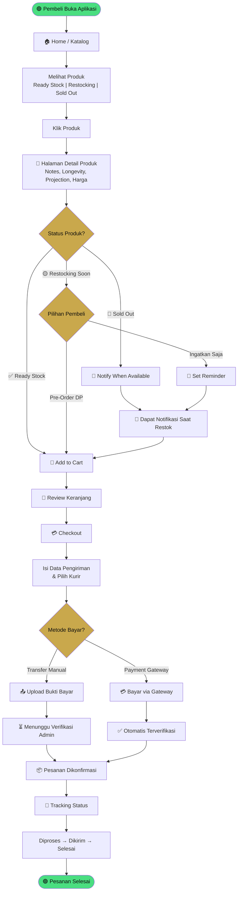
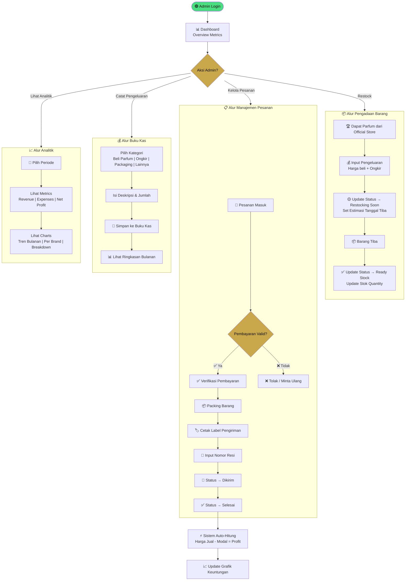
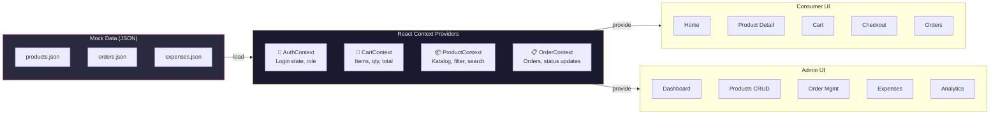

# Parfume Reseller Dashboard — Flowcharts

## 1. Arsitektur Navigasi (Sitemap)

---

## 2. Alur Pembeli (Consumer Journey)

---

## 3. Alur Reseller / Admin

---

## 4. Alur Data & State Management

